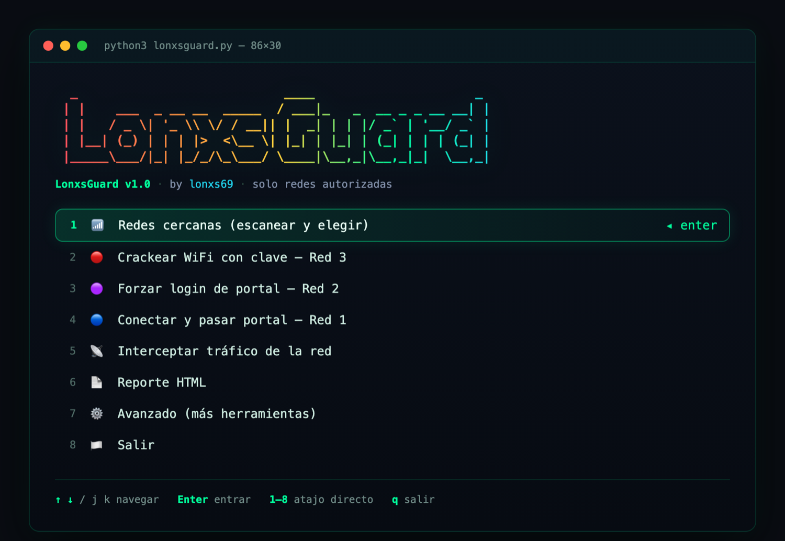
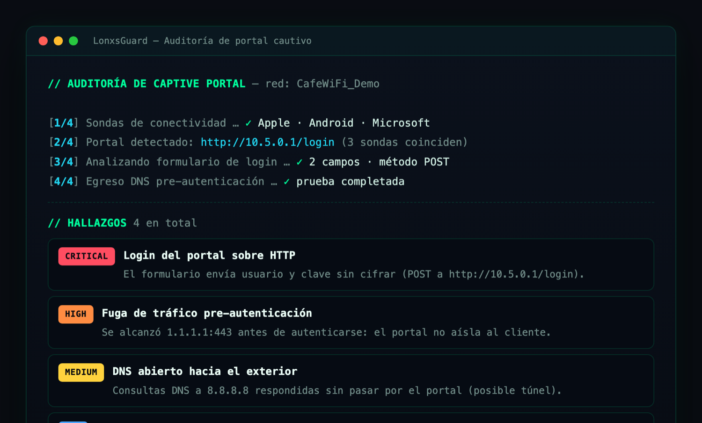
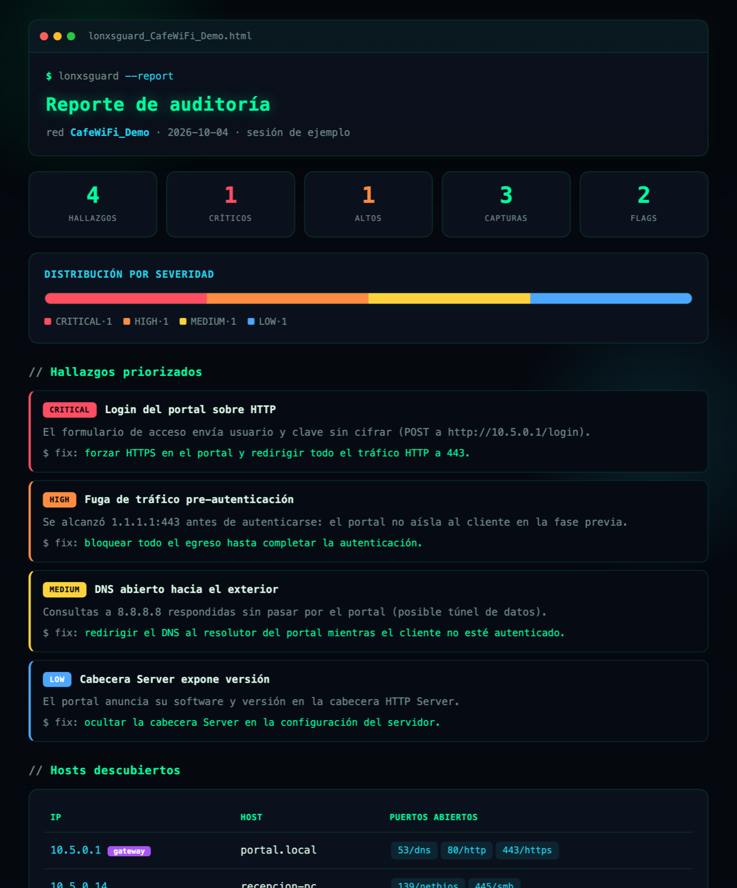

<h1 align="center">🛡️ LonxsGuard</h1>

<p align="center"><b>Toolkit de auditoría de seguridad de redes para macOS — en una sola terminal interactiva.</b></p>

<p align="center">
  
  
  
  
  <a href="https://github.com/Lonxs69/LonxsGuard/stargazers"></a>
  
</p>

<p align="center">
Un comando, un menú navegable y un reporte HTML con estética de terminal.<br>
<b>Cero dependencias externas</b> — solo la librería estándar de Python y herramientas nativas de macOS.
</p>

<p align="center">
  
</p>

---

## ✨ ¿Qué hace?

LonxsGuard reúne en una interfaz limpia las fases típicas de una auditoría de red,
pensado para redes **propias o con autorización explícita**:

| Módulo | Descripción |
|--------|-------------|
| 📶 **Reconocimiento Wi-Fi** | Escanea redes cercanas (SSID, señal, canal, seguridad) sin conectarse |
| 🚪 **Auditoría de captive portal** | Detección multi-sonda (Apple/Android/Microsoft), login sobre HTTP, fuga pre-auth, DNS abierto |
| 📡 **Interceptación de tráfico** | Captura cabeceras HTTP y cookies con `tcpdump` sobre redes autorizadas |
| 🍪 **Análisis de cookies / JWT** | Decodifica tokens y extrae fechas y marcas de tiempo automáticamente |
| 🗺️ **Enumeración de hosts** | Descubre equipos y puertos abiertos con `nmap` (o caché ARP, sin privilegios) |
| 🔑 **Pruebas de login web** | Revisa formularios con autodetección de campos, sobre sistemas propios |
| 🧰 **Caja de herramientas** | Buscador de puertos web, matriz de salida, utilidades de MAC/DHCP |
| 📄 **Reporte HTML** | Dashboard de una página: severidad, hallazgos priorizados y hosts |

> Todo corre con la **librería estándar de Python** + herramientas nativas de macOS
> (`networksetup`, `system_profiler`, `tcpdump`, `dig`, `arp`) + `nmap` opcional.

---

## 📸 Capturas

### Un módulo en acción — auditoría de portal cautivo

Cada módulo imprime el avance paso a paso y clasifica los hallazgos por severidad
(los datos de abajo son de una **sesión de ejemplo**, no de una red real):

<p align="center">
  
</p>

### El reporte HTML

Al final de la sesión, un **dashboard de una sola página** con estética de terminal:
resumen por severidad, hallazgos priorizados con su recomendación de arreglo y los hosts descubiertos.
Ligero, sin librerías pesadas, se abre en cualquier navegador.

<p align="center">
  
</p>

---

## 🖥️ Requisitos

- **macOS** (probado en versiones recientes)
- **Python 3.9+** (viene con macOS)
- `nmap` opcional, para enumeración de puertos: `brew install nmap`

---

## 📦 Instalación

```bash
git clone https://github.com/Lonxs69/LonxsGuard.git
cd LonxsGuard
chmod +x lonxsguard.py
python3 lonxsguard.py
```

<details>
<summary><b>Comando global (opcional)</b></summary>

Para lanzarlo desde cualquier lugar escribiendo `LonxsGuard`:

```bash
sudo ln -sf "$PWD/lonxsguard.py" /usr/local/bin/LonxsGuard
chmod +x /usr/local/bin/LonxsGuard
```
</details>

---

## 🚀 Uso

```bash
python3 lonxsguard.py
```

- Navega el menú con **↑ / ↓** (o `j` / `k`), **Enter** para entrar, **q** para salir.
- Teclas **1–8** como atajo directo a cada módulo.
- El estado (hallazgos, capturas, hosts) se acumula durante la sesión y se vuelca al reporte.

El módulo de interceptación pide `sudo`. Los reportes se guardan en `reports/`
y se abren en el navegador.

Para el reconocimiento Wi-Fi, macOS puede requerir activar **Localización** para tu terminal:
*Ajustes del Sistema → Privacidad y seguridad → Localización*.

<details>
<summary><b>Diccionarios</b></summary>

Las listas de palabras viven en `wordlists/`. Incluye `starter.txt` y `espanol.txt`.
Puedes añadir las tuyas: cualquier `.txt` aparece automáticamente en el menú.
</details>

---

## ⚠️ Aviso legal

LonxsGuard es una herramienta **educativa y de auditoría defensiva**.
Úsala **únicamente** sobre redes y sistemas de tu propiedad o para los que
tengas **autorización por escrito**. El acceso no autorizado a redes o
sistemas de terceros es **ilegal**. El autor no se hace responsable del mal uso.

---

## 📝 Licencia

[MIT](LICENSE) © 2026 **Junior De León** ([@lonxs69](https://github.com/Lonxs69))
